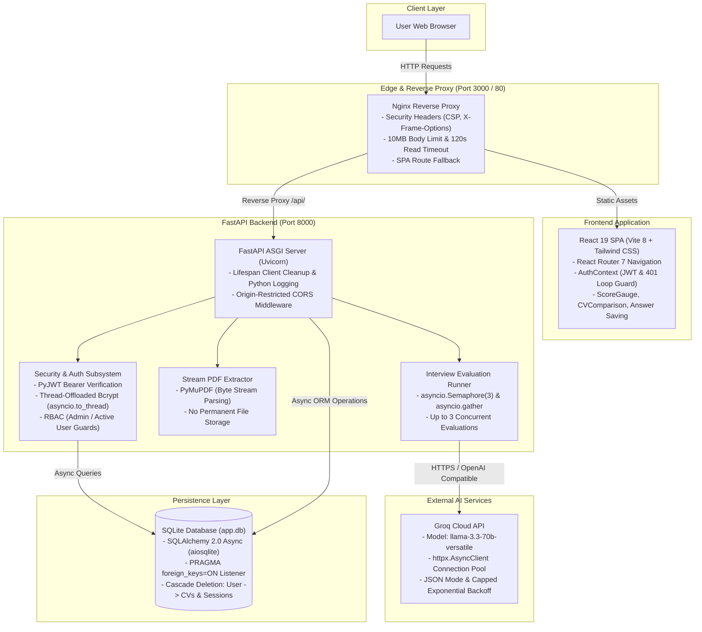

# CareerAI — AI-Powered CV Optimizer & Mock Interview Platform

[](https://github.com/Danx-T/CareerAI/actions/workflows/ci.yml)
[](https://www.python.org/downloads/release/python-3110/)
[](https://fastapi.tiangolo.com/)
[](https://react.dev/)
[](https://groq.com/)
[](https://www.docker.com/)

CareerAI is a full-stack career preparation web application. It uses cloud LLM inference (Groq) to tailor CVs to specific job descriptions and conducts multi-category mock interviews with post-session concurrent answer evaluation, per-question scoring, and session performance reports.

---

## Table of Contents

- [Platform Overview](#platform-overview)
- [Target Use Cases](#target-use-cases)
- [Architectural Highlights](#architectural-highlights)
- [System Architecture](#system-architecture)
- [Comprehensive API Reference](#comprehensive-api-reference)
- [Environment Variables](#environment-variables)
- [Getting Started & Local Setup](#getting-started--local-setup)
  - [Prerequisites](#prerequisites)
  - [Backend Setup](#1-backend-setup)
  - [Frontend Setup](#2-frontend-setup)
  - [Creating an Administrator Account](#3-creating-an-administrator-account)
- [Automated Testing](#automated-testing)
- [Docker Deployment](#docker-deployment)
- [Known Limitations](#known-limitations)
- [Project Layout](#project-layout)

---

## Platform Overview

CareerAI helps candidates prepare for technical and behavioral hiring processes:
- **CV Optimization Engine**: Upload a PDF CV, provide a target job title and job description, and receive a tailored CV rewrite alongside a match score, missing keyword analysis, and actionable refinement recommendations.
- **Interactive Mock Interview Coach**: Generate role-specific interview questions categorized across behavioral, technical, and situational topics. Save answers at your own pace during the session and submit when ready for batch AI evaluation.
- **Session Performance Reports**: Receive post-session interview breakdowns with category score averages, top candidate strengths, areas for improvement, and model answer hints.
- **Administrative Dashboard**: Role-Based Access Control (RBAC) enabling administrators to view platform usage statistics, manage user active/admin states, and inspect or remove interview sessions.

---

## Target Use Cases

1. **Job Seekers & Software Engineers**: Tailor resume phrasing and structure to specific job descriptions and practice technical and behavioral interview questions.
2. **Career Coaches & Mentors**: Review structured practice session reports with candidates to identify gaps in interview responses.
3. **Bootcamps & University Career Centers**: Provide students with self-service resume review and mock interview practice.

---

## Architectural Highlights

### 1. Stream-Based PDF Text Extraction (No Permanent File Storage)
- Powered by **PyMuPDF (`pymupdf.open(stream=content, filetype="pdf")`)**.
- Uploaded PDFs are read with a bounded size check (`MAX_FILE_SIZE_MB`) and parsed directly from the byte buffer without saving uploaded files to an application uploads directory. *(Note: during multipart request parsing, Starlette's `UploadFile` uses a `SpooledTemporaryFile` that keeps uploads up to 1 MB in RAM and spools larger uploads up to the size limit to OS temporary storage before cleanup.)*
- Joins multi-page text cleanly without injecting page separator markers into the LLM prompt.
- Rejects scanned/image-only PDFs that contain no extractable text with HTTP 422.

### 2. Cloud LLM Integration (Groq Cloud)
- Standardized on Groq Cloud running **`llama-3.3-70b-versatile`** via OpenAI-compatible chat completion endpoints.
- Reuses a shared `httpx.AsyncClient(timeout=120.0)` connection pool across requests and closes it cleanly during FastAPI lifespan shutdown.
- Uses JSON mode (`response_format={"type": "json_object"}`) paired with fallback parsers and output sanitizers to strip markdown code fences and conversational preambles.
- Implements exponential backoff retry for HTTP 429 rate limits and 5xx server errors (honoring `Retry-After` headers capped at 20 seconds), while failing immediately on non-retryable 4xx client errors.

### 3. Concurrent Post-Session Answer Evaluation
- Evaluates up to 3 answers concurrently when a session is completed using `asyncio.Semaphore(3)` and `asyncio.gather`, reducing total evaluation time compared to sequential requests while respecting API rate limits.
- Commits per-question evaluations to the database before generating the overall session summary report, ensuring that evaluated answers are preserved if the final report call fails and avoiding duplicate token usage on retry.
- Isolates individual question evaluation errors so a single failed question does not abort the rest of the session.

### 4. Asynchronous Auth & Role-Based Access Control (RBAC)
- Built on **FastAPI** and **SQLAlchemy 2.0 (async)** with **aiosqlite**.
- Enforces SQLite foreign keys on every database connection via an engine event listener (`PRAGMA foreign_keys=ON`), ensuring `cascade="all, delete-orphan"` relationships clean up child records on deletion.
- OAuth2 Bearer authentication using **PyJWT** (`HS256`, 24-hour token expiration) and a `SECRET_KEY` length guard ($\ge$ 32 characters enforced at startup).
- Offloads CPU-bound **bcrypt** hashing and verification to a thread pool via `asyncio.to_thread`, equalizes login verification timing for non-existent emails using a precomputed dummy hash, and enforces bcrypt's 72-byte UTF-8 password limit.
- Blocks deactivated accounts (`is_active=False`) on both login and authenticated API requests.

### 5. Automated Testing & CI Pipeline
- **109 backend Pytest tests + 7 frontend automated tests** covering JSON parsing fallbacks, score/list sanitizers, `respx`-mocked HTTP retry/backoff behavior, PyMuPDF extraction, authentication, admin RBAC & CLI provisioning, CV workflows, cascade deletions, interview evaluation flows, Axios 401 loop-guard interceptors, and React component rendering.
- Deterministic test execution using monkeypatched mock AI fixtures and `respx`, requiring no live Groq API keys in CI or local test runs.
- Dual-job **GitHub Actions CI pipeline** (`.github/workflows/ci.yml`) running Python 3.11 (`pyflakes` + `pytest`) and Node 20 (`npm run lint` + `npm test` + `npm run build`) on pushes and pull requests.

### 6. Multi-Stage Docker & Nginx Configuration
- **Backend**: `python:3.11-slim` container running as a non-root user (`app`) with a dedicated `/app/data` volume for the SQLite database.
- **Frontend**: Two-stage Docker build using `node:20-alpine` for bundling and `nginx:alpine` for static file serving and `/api/` reverse proxying.
- **Nginx Reverse Proxy**: Configured with `client_max_body_size 10m;`, `proxy_read_timeout 120s;`, SPA fallback routing (`try_files $uri $uri/ /index.html;`), and standard HTTP security headers (`X-Frame-Options DENY`, `X-Content-Type-Options nosniff`, `Content-Security-Policy`, and `Referrer-Policy`).

---

## System Architecture



---

## Comprehensive API Reference

The backend exposes 19 application endpoints across 4 functional domains, plus 2 system health endpoints:

### Authentication (`/api/auth`)

| Method | Endpoint | Description | Request Payload / Params | Auth / Role | Status Codes |
|---|---|---|---|---|---|
| `POST` | `/api/auth/register` | Register a new user account | **JSON**: `{ email, full_name, password }` (password 8 chars to 72 UTF-8 bytes) | Public | `201 Created`<br>`400 Bad Request`<br>`422 Unprocessable` |
| `POST` | `/api/auth/login` | Authenticate and obtain JWT Bearer access token | **Form**: `username` (email), `password` | Public | `200 OK`<br>`401 Unauthorized`<br>`403 Forbidden` |
| `GET` | `/api/auth/me` | Retrieve profile of currently authenticated user | None | Bearer Token (Active User) | `200 OK`<br>`401 Unauthorized`<br>`403 Forbidden` |

### CV Optimization (`/api/cv`)

| Method | Endpoint | Description | Request Payload / Params | Auth / Role | Status Codes |
|---|---|---|---|---|---|
| `POST` | `/api/cv/upload` | Extract text from an uploaded PDF without permanent file storage | **Multipart**: `file: UploadFile` (PDF format, $\le$ 10MB) | Bearer Token (Active User) | `200 OK`<br>`400 Bad Request`<br>`401 Unauthorized`<br>`422 Unprocessable` |
| `POST` | `/api/cv/optimize` | Run AI CV optimization & save result to history | **JSON**: `{ cv_text, job_title, job_description }` | Bearer Token (Active User) | `200 OK`<br>`400 Bad Request`<br>`401 Unauthorized`<br>`422 Unprocessable`<br>`503 Service Unavailable` |
| `GET` | `/api/cv/history` | List current user's CV optimization history (newest first) | None | Bearer Token (Active User) | `200 OK`<br>`401 Unauthorized` |
| `DELETE` | `/api/cv/history/{id}` | Delete a CV optimization record | **Path**: `id: int` | Bearer Token (Owner) | `204 No Content`<br>`401 Unauthorized`<br>`404 Not Found` |

### Mock Interview Coach (`/api/interview`)

| Method | Endpoint | Description | Request Payload / Params | Auth / Role | Status Codes |
|---|---|---|---|---|---|
| `POST` | `/api/interview/start` | Initialize session and generate role-specific questions | **JSON**: `{ job_title, job_description, num_questions }` (1–20) | Bearer Token (Active User) | `201 Created`<br>`401 Unauthorized`<br>`422 Unprocessable`<br>`503 Service Unavailable` |
| `GET` | `/api/interview/sessions` | List current user's interview sessions | None | Bearer Token (Active User) | `200 OK`<br>`401 Unauthorized` |
| `GET` | `/api/interview/{id}` | Retrieve session details, questions, and saved answers | **Path**: `id: int` | Bearer Token (Owner) | `200 OK`<br>`401 Unauthorized`<br>`404 Not Found` |
| `PATCH` | `/api/interview/{id}/answer/{qid}` | Save or clear a candidate answer (no AI call) | **Path**: `id: int`, `qid: int`<br>**JSON**: `{ answer: str }` | Bearer Token (Owner) | `200 OK`<br>`401 Unauthorized`<br>`404 Not Found`<br>`409 Conflict` |
| `POST` | `/api/interview/{id}/complete` | Concurrently evaluate saved answers & generate session report | **Path**: `id: int` | Bearer Token (Owner) | `200 OK`<br>`401 Unauthorized`<br>`404 Not Found`<br>`409 Conflict`<br>`503 Service Unavailable` |

### Administration (`/api/admin`)

| Method | Endpoint | Description | Request Payload / Params | Auth / Role | Status Codes |
|---|---|---|---|---|---|
| `GET` | `/api/admin/stats` | Aggregate platform statistics and session metrics | None | Bearer Token (`is_admin=True`) | `200 OK`<br>`401 Unauthorized`<br>`403 Forbidden` |
| `GET` | `/api/admin/users` | List all registered users (newest first) | None | Bearer Token (`is_admin=True`) | `200 OK`<br>`401 Unauthorized`<br>`403 Forbidden` |
| `PATCH` | `/api/admin/users/{id}/toggle-active` | Toggle active/deactivated status for a user | **Path**: `id: int` | Bearer Token (`is_admin=True`) | `200 OK`<br>`400 Bad Request`<br>`401 Unauthorized`<br>`403 Forbidden`<br>`404 Not Found` |
| `PATCH` | `/api/admin/users/{id}/toggle-admin` | Toggle administrator privileges for a user | **Path**: `id: int` | Bearer Token (`is_admin=True`) | `200 OK`<br>`400 Bad Request`<br>`401 Unauthorized`<br>`403 Forbidden`<br>`404 Not Found` |
| `DELETE` | `/api/admin/users/{id}` | Delete user & cascade delete all user data | **Path**: `id: int` | Bearer Token (`is_admin=True`) | `204 No Content`<br>`400 Bad Request`<br>`401 Unauthorized`<br>`403 Forbidden`<br>`404 Not Found` |
| `GET` | `/api/admin/sessions` | List all interview sessions across all users | None | Bearer Token (`is_admin=True`) | `200 OK`<br>`401 Unauthorized`<br>`403 Forbidden` |
| `DELETE` | `/api/admin/sessions/{id}` | Delete an interview session & cascade delete questions | **Path**: `id: int` | Bearer Token (`is_admin=True`) | `204 No Content`<br>`401 Unauthorized`<br>`403 Forbidden`<br>`404 Not Found` |

### System & Health

| Method | Endpoint | Description | Request Payload / Params | Auth / Role | Status Codes |
|---|---|---|---|---|---|
| `GET` | `/` | Application metadata and status | None | Public | `200 OK` |
| `GET` | `/health` | Service health check | None | Public | `200 OK` |

---

## Environment Variables

Configure application settings by copying `.env.example` to `.env` in the repository root (or inside `backend/`):

| Variable | Type | Default Value | Required | Description |
|---|---|---|:---:|---|
| `SECRET_KEY` | `str` | `""` | **YES** | Secret key for signing JWT tokens (minimum 32 characters; 64+ recommended). Startup fails if missing or shorter than 32 characters. |
| `GROQ_API_KEY` | `str` | `""` | **YES** | Groq Cloud API authentication key (obtain from [console.groq.com/keys](https://console.groq.com/keys)). |
| `GROQ_MODEL` | `str` | `"llama-3.3-70b-versatile"` | No | Groq LLM model identifier. |
| `GROQ_BASE_URL` | `str` | `"https://api.groq.com/openai/v1"` | No | OpenAI-compatible base URL for Groq API requests. |
| `DATABASE_URL` | `str` | `"sqlite+aiosqlite:///./app.db"` | No | Async SQLAlchemy database URL. In Docker Compose: `sqlite+aiosqlite:////app/data/app.db`. |
| `FRONTEND_URL` | `str` | `"http://localhost:3000"` | No | Allowed origin for Cross-Origin Resource Sharing (CORS). |
| `DEBUG` | `bool` | `False` | No | Enables interactive Swagger/OpenAPI docs at `/docs` and `/redoc` when set to `true` (keep `false` in production). |
| `MAX_FILE_SIZE_MB` | `int` | `10` | No | Maximum permitted PDF upload size in megabytes. |
| `ALGORITHM` | `str` | `"HS256"` | No | JWT signature algorithm. |
| `ACCESS_TOKEN_EXPIRE_MINUTES` | `int` | `1440` (24h) | No | Access token expiration window in minutes. |
| `VITE_API_URL` | `str` | `""` | No | Frontend API base URL. Leave empty to use same-origin proxy (Vite dev proxy or Nginx). |

---

## Getting Started & Local Setup

### Prerequisites

- **Python**: Version 3.11 or higher
- **Node.js**: Version 20 LTS or higher (with `npm`)
- **Groq API Key**: Obtain a free API key from [Groq Cloud Console](https://console.groq.com/keys)

---

### 1. Backend Setup

```bash
# Navigate to backend directory
cd backend

# Create and activate Python virtual environment
python -m venv venv

# Windows (PowerShell / Command Prompt)
venv\Scripts\activate

# macOS / Linux
source venv/bin/activate

# Install runtime and development dependencies
pip install -r requirements.txt -r requirements-dev.txt

# Copy environment template from repository root
cp ../.env.example .env
# Windows: copy ..\.env.example .env
```

Edit `.env` and set your keys:
```env
SECRET_KEY=your-random-secret-key-at-least-32-characters-long
GROQ_API_KEY=your_groq_api_key_here
DEBUG=true
```
> Tip: Generate a strong `SECRET_KEY` using:
> `python -c "import secrets; print(secrets.token_urlsafe(64))"`

Start the FastAPI development server:
```bash
uvicorn app.main:app --reload --port 8000
```
- **Backend API URL**: `http://localhost:8000`
- **Interactive OpenAPI Documentation**: `http://localhost:8000/docs` *(available when `DEBUG=true` in `.env`)*

---

### 2. Frontend Setup

In a separate terminal window:
```bash
# Navigate to frontend directory
cd frontend

# Install dependencies
npm install

# (Optional) Configure environment file
cp .env.example .env
# Leave VITE_API_URL empty to use Vite's local /api reverse proxy

# Start Vite development server
npm run dev
```
- **Frontend Application URL**: `http://localhost:3000`
- The Vite dev server automatically proxies `/api/*` requests to `http://localhost:8000`.

---

### 3. Creating an Administrator Account

Use the standalone CLI script to create a new administrator account or promote an existing user:

```bash
# Run from the backend directory (interactive prompt):
python -m app.scripts.create_admin

# Or pass arguments directly:
python -m app.scripts.create_admin --email admin@example.com --password "SecureAdminPass123" --full-name "Admin User"
```

The script:
1. Normalizes the email address and validates password length (8 characters minimum, 72 UTF-8 bytes maximum).
2. Initializes database tables if they do not exist yet.
3. Creates a new admin user or promotes an existing user with that email to `is_admin = True` and `is_active = True`.

---

## Automated Testing

Run the backend and frontend test suites locally:

```bash
# Backend lint & test suite (from backend/ directory)
python -m pyflakes app/ tests/
pytest -v tests/

# Frontend lint & test suite (from frontend/ directory)
npm run lint
npm test
```

### Test Suite Breakdown
- **Backend Automated Tests**: **109 tests** (`pytest`)
  - `tests/test_ai_helpers.py` (56 tests): JSON extraction fallbacks, score clamping (`_to_score` & `_to_score_optional`), list/dict string sanitization (`_to_str_list`), category normalization, CV text cleanup, PyMuPDF stream extraction, `respx`-mocked HTTP retry/backoff (`429` with `Retry-After` cap, `503` retry, `401` immediate failure), and question/evaluation edge cases.
  - `tests/test_auth.py` (11 tests): Registration, email normalization, duplicate email rejection, bcrypt 72-byte password boundary checks, login verification (including dummy hash timing check), deactivated account blocking, `create_admin` CLI script, and `/api/admin/*` RBAC endpoints.
  - `tests/test_cv.py` (20 tests): Bounded upload size checks, PDF magic byte validation, corrupt/empty PDF rejection, CV optimization persistence, input length validation, user history isolation, and SQLite foreign-key cascade deletion.
  - `tests/test_interview.py` (22 tests): Session creation, question count slicing, answer saving/clearing, partial evaluation preservation and answer edit reset when report generation fails, conflict guards (`409 Conflict` on completed sessions), and cross-user session isolation.
- **Frontend Automated Tests**: **7 tests** (`node --test`)
  - `tests/app.test.js` (7 tests): Axios JWT request interceptor header injection, 401 response interceptor login loop guard vs. protected route redirect, `CVComparison` placeholder and React HTML-escaping behavior, `ScoreGauge` SVG rendering, `LoadingSpinner` rendering, and `Landing` page router links.

---

## Docker Deployment

Build and run the full stack with Docker Compose v2:

```bash
# 1. Copy and edit .env at repository root
cp .env.example .env

# 2. Build and start containers in detached mode
docker compose up --build -d

# 3. Follow container logs
docker compose logs -f
```

### Container Services
- **Backend (`backend`)**: Runs FastAPI inside `python:3.11-slim` as non-root user `app` on internal port `8000` (`expose: ["8000"]`, accessible only via the Nginx reverse proxy on the Docker network), storing the SQLite database in the `db_data` Docker volume (`/app/data/app.db`).
- **Frontend (`frontend`)**: Builds the React SPA with `node:20-alpine` and serves static assets plus `/api/` reverse proxying via `nginx:alpine` on host port `3000` (container port `80`), including rate limiting on `/api/auth/login` and `/api/auth/register` (`10r/m`, `burst=5`) and strict `script-src 'self'` CSP.
- **Accessing the Stack**:
  - Web Application: `http://localhost:3000`
  - Proxied Backend API: `http://localhost:3000/api/`

To stop and remove containers:
```bash
docker compose down
```

---

## Known Limitations

- **Non-deterministic LLM outputs**: CV match scores, rewritten CVs, interview questions, and answer evaluations are generated by an external LLM (`llama-3.3-70b-versatile`) and can vary across runs for identical inputs. Users can still influence their own evaluation results through adversarial text (mitigated via system-role separation and XML angle-bracket escaping).
- **Input character limits**: CV text is limited to `20,000` characters and job descriptions to `10,000` characters (aligned across frontend inputs, Pydantic validation schemas, and LLM prompt builders; per-question `evaluate_answer` calls include up to `2,000` characters of job description context to stay within provider token-per-minute limits during concurrent evaluation).
- **Text-based PDFs only (no OCR)**: PDF extraction relies on embedded text streams via PyMuPDF. Scanned or image-only PDFs without an embedded text layer are rejected with HTTP 422.
- **Single-instance SQLite persistence**: SQLite (`aiosqlite`) is intended for local development, portfolio demonstrations, and single-container deployments. Multi-replica horizontal scaling would require migrating to PostgreSQL.
- **Edge-only rate limiting**: Rate limiting on `/api/auth/login` and `/api/auth/register` is enforced in the Nginx reverse proxy (`frontend/nginx.conf`); running the FastAPI backend directly without Nginx does not enforce application-level rate limits.

---

## Project Layout

```
CareerAI/
├── .github/
│   └── workflows/
│       └── ci.yml               # GitHub Actions CI workflow (Python & Node)
├── backend/
│   ├── app/
│   │   ├── core/
│   │   │   ├── config.py        # Pydantic Settings v2 configuration & startup checks
│   │   │   └── security.py      # PyJWT auth, thread-offloaded bcrypt, user dependencies
│   │   ├── db/
│   │   │   ├── database.py      # SQLAlchemy 2.0 async engine & PRAGMA foreign_keys listener
│   │   │   └── init_db.py       # Database table initialization helper
│   │   ├── models/
│   │   │   ├── cv.py            # CVOptimization ORM model
│   │   │   ├── interview.py     # InterviewSession & InterviewQuestion models
│   │   │   └── user.py          # User model with cascade relationships
│   │   ├── routers/
│   │   │   ├── admin.py         # Platform stats & user/session administration
│   │   │   ├── auth.py          # Registration, login, and user profile routes
│   │   │   ├── cv.py            # Stream PDF upload & CV optimization routes
│   │   │   └── interview.py     # Mock interview generation & concurrent evaluation
│   │   ├── schemas/
│   │   │   ├── cv.py            # Pydantic validation schemas for CV workflows
│   │   │   ├── interview.py     # Pydantic schemas for interview sessions & feedback
│   │   │   └── user.py          # User schemas with 72-byte password validation
│   │   ├── scripts/
│   │   │   └── create_admin.py  # Standalone CLI admin provisioning script
│   │   ├── services/
│   │   │   ├── ai_service.py    # Groq Cloud LLM client, JSON mode, backoff retry
│   │   │   └── pdf_service.py   # PyMuPDF stream text extraction
│   │   └── main.py              # FastAPI app initialization, lifespan, and CORS
│   ├── tests/                   # 109 automated Pytest tests
│   │   ├── conftest.py          # Test database lifecycle & deterministic mock AI fixtures
│   │   ├── test_ai_helpers.py   # JSON parsing, sanitizers, respx retry & PDF tests
│   │   ├── test_auth.py         # Authentication, create_admin CLI & admin RBAC tests
│   │   ├── test_cv.py           # CV upload, optimization & cascade deletion tests
│   │   └── test_interview.py    # Interview session, answer & evaluation tests
│   ├── .dockerignore            # Backend Docker build context exclusions
│   ├── Dockerfile               # Non-root Python 3.11 container
│   ├── pytest.ini               # Pytest configuration
│   ├── requirements.txt         # Production runtime dependencies
│   └── requirements-dev.txt     # Test & development dependencies
├── frontend/
│   ├── src/
│   │   ├── components/          # Reusable UI components (Sidebar, ScoreGauge, etc.)
│   │   ├── context/             # AuthContext with 401 loop guard
│   │   ├── pages/               # Application views (Landing, Dashboard, CV*, Interview*, Admin)
│   │   ├── services/            # Axios API client (api.js)
│   │   ├── App.jsx              # React Router 7 routing & layout
│   │   └── main.jsx             # React 19 entry point
│   ├── tests/
│   │   └── app.test.js          # Automated frontend interceptor & component tests
│   ├── .dockerignore            # Frontend Docker build context exclusions (node_modules, dist)
│   ├── .env.example             # Frontend environment template
│   ├── nginx.conf               # Production Nginx reverse proxy & security headers
│   ├── Dockerfile               # Multi-stage production container build
│   ├── package.json             # Frontend dependencies & scripts
│   ├── tailwind.config.js       # Tailwind CSS configuration
│   └── vite.config.js           # Vite build configuration & dev proxy
├── .env.example                 # Root environment variables template
├── docker-compose.yml           # Multi-container orchestration specification
└── README.md                    # Project documentation
```
