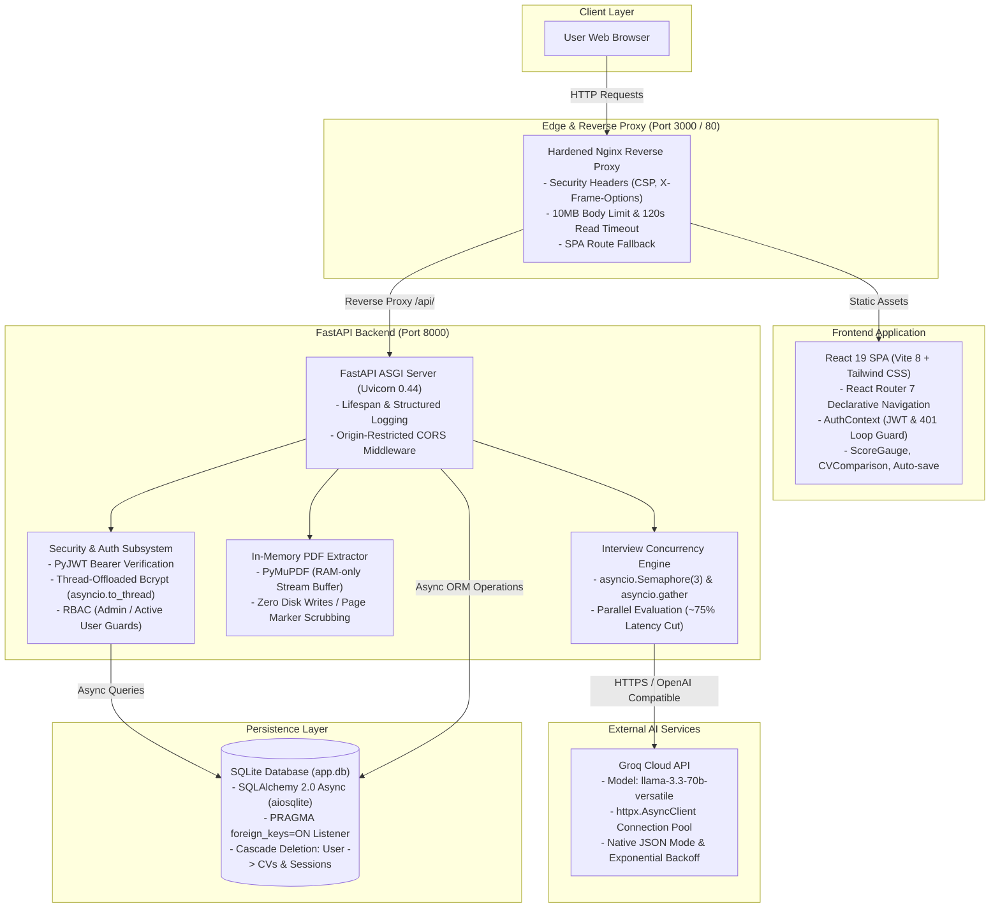

# CareerAI — AI-Powered CV Optimizer & Mock Interview Platform

[](https://github.com/Danx-T/CareerAI/actions/workflows/ci.yml)
[](https://www.python.org/downloads/release/python-3110/)
[](https://fastapi.tiangolo.com/)
[](https://react.dev/)
[](https://groq.com/)
[](https://pytest.org/)
[](https://www.docker.com/)

CareerAI is an enterprise-grade full-stack career preparation platform. It leverages high-throughput cloud LLM inference to tailor CVs to specific job descriptions and conducts rigorous, multi-category mock interviews with real-time answer evaluations, detailed scoring, and executive performance reporting.

---

## Table of Contents

- [Platform Overview](#platform-overview)
- [Target Use Cases](#target-use-cases)
- [Architectural Highlights](#architectural-highlights)
- [System Architecture](#system-architecture)
- [Comprehensive API Reference](#comprehensive-api-reference)
- [Environment Variables](#environment-variables)
- [Getting Started & Local Setup](#getting-started--local-setup)
  - [Prerequisites](#prerequisites)
  - [Backend Setup](#1-backend-setup)
  - [Frontend Setup](#2-frontend-setup)
  - [Creating an Administrator Account](#3-creating-an-administrator-account)
- [Automated Testing](#automated-testing)
- [Docker Deployment](#docker-deployment)
- [Project Layout](#project-layout)

---

## Platform Overview

CareerAI bridges the gap between job seekers and competitive hiring processes:
- **CV Optimization Engine**: Upload your PDF CV, target a specific job title and job description, and receive an ATS-optimized CV rewrite alongside quantitative match scoring, missing keyword analysis, and actionable refinement recommendations.
- **Interactive Mock Interview Coach**: Generate role-specific interview questions categorized across behavioral, technical, and situational competencies. Practice under simulated interview conditions with autosaved responses and concurrent AI answer evaluation.
- **Executive Performance Reports**: Receive holistic interview breakdowns with category scores, synthesized top candidate strengths, targeted areas for improvement, and model answer guidance hints.
- **Administrative Suite**: Role-Based Access Control (RBAC) enabling administrators to inspect platform usage metrics, manage user access states, promote administrators, and audit interview sessions.

---

## Target Use Cases

1. **Job Seekers & Software Engineers**: Tailor resumes to beat Applicant Tracking Systems (ATS) and practice challenging technical and behavioral interview scenarios.
2. **Career Coaches & Mentors**: Guide candidates with structured performance reports, identifying concrete gaps in candidate responses.
3. **Bootcamps & Educational Institutions**: Provide students with on-demand, automated interview preparation and resume alignment tools.
4. **Hiring Teams**: Benchmark job description expectations against candidate experience profiles.

---

## Architectural Highlights

### 1. Zero-Retention In-Memory PDF Extraction
- Powered by **PyMuPDF (`pymupdf.open(stream=content, filetype="pdf")`)**.
- Incoming PDF files are processed purely in RAM buffers through FastAPI upload streams without writing any temporary files or permanent artifacts to disk.
- Automatically strips page separator artifacts to supply clean contextual text to the language model.
- Automatically rejects scanned/image-only PDFs lacking extractable text, protecting LLM token windows.

### 2. High-Throughput Cloud LLM Integration (Groq Cloud)
- Standardized on Groq Cloud running **`llama-3.3-70b-versatile`** over OpenAI-compatible endpoints.
- Reuses a persistent connection pool via singleton `httpx.AsyncClient(timeout=120.0)` for minimal connection overhead and graceful shutdown handling.
- Native JSON mode (`response_format={"type": "json_object"}`) enforced with multi-stage fallback sanitizers to eliminate markdown fences and conversational preambles.
- Robust exponential backoff retry mechanism handling HTTP 429 rate limits and 5xx transient server errors with dynamic `Retry-After` header extraction, while failing immediately on non-retryable 4xx client errors.

### 3. Concurrent Answer Evaluation Engine
- Slashing report generation latency by **~75–80%** compared to sequential processing.
- Utilizes `asyncio.Semaphore(3)` combined with `asyncio.gather` to evaluate multiple interview questions in parallel while respecting provider rate and token limits.
- Fault-tolerant error isolation ensures that individual question evaluation failures do not abort the overall interview session report.

### 4. Asynchronous Security & Role-Based Access Control (RBAC)
- Built on **FastAPI** and **SQLAlchemy 2.0 (async)** with **aiosqlite**.
- Enforces SQLite foreign keys on every database connection via an engine sync event listener (`PRAGMA foreign_keys=ON`), guaranteeing complete cascade deletions (`cascade="all, delete-orphan"`).
- OAuth2 Bearer authentication using **PyJWT** (`HS256`, 24-hour expiration).
- Non-blocking CPU-bound password hashing and verification using **bcrypt** executed in thread pools via `asyncio.to_thread`.
- Password boundary enforcement strictly limits passwords to 72 UTF-8 bytes to prevent bcrypt truncation vulnerabilities.
- Proactive account deactivation protection rejecting deactivated accounts across both login attempts and authenticated request flows.

### 5. Production-Grade Testing & CI/CD Pipeline
- **98 automated Pytest tests** verifying JSON parsing fallbacks, boundary clamping, in-memory PDF extraction, authentication, CV workflows, cascade deletions, and concurrent interview evaluation.
- Deterministic test isolation using monkeypatched mock AI fixtures, requiring no live Groq API keys during test execution.
- Automated dual-job **GitHub Actions CI/CD pipeline** (`.github/workflows/ci.yml`) testing Python 3.11 (Pyflakes linting + Pytest suite) and Node 20 (ESLint 9 + Vite 8 production build) on every push and pull request.

### 6. Hardened Multi-Stage Containerization
- **Backend**: Python 3.11-slim container running as an unprivileged non-root user (`app`), pre-configured directory permissions for SQLite persistent storage, and self-contained PyMuPDF binary wheels.
- **Frontend**: Two-stage Docker build utilizing `node:20-alpine` for production bundling and `nginx:alpine` for static delivery.
- **Nginx Reverse Proxy**: Hardened configuration featuring 10MB client upload capacity (`client_max_body_size 10m;`), 120-second backend timeout (`proxy_read_timeout 120s;`), SPA client routing fallback (`try_files $uri $uri/ /index.html;`), and strict HTTP security headers (`X-Frame-Options DENY`, `X-Content-Type-Options nosniff`, `CSP`, and `Referrer-Policy`).

---

## System Architecture



---

## Comprehensive API Reference

The backend exposes 19 application endpoints across 4 functional domains, plus service health monitoring endpoints:

### Authentication (`/api/auth`)

| Method | Endpoint | Description | Request Payload / Params | Auth / Role | Status Codes |
|---|---|---|---|---|---|
| `POST` | `/api/auth/register` | Register a new user account | **JSON**: `{ email, full_name, password }` (password max 72 bytes) | Public | `201 Created`<br>`400 Bad Request`<br>`422 Unprocessable` |
| `POST` | `/api/auth/login` | Authenticate and obtain JWT Bearer access token | **Form**: `username` (email), `password` | Public | `200 OK`<br>`401 Unauthorized`<br>`403 Forbidden` |
| `GET` | `/api/auth/me` | Retrieve profile of currently authenticated user | None | Bearer Token (Active User) | `200 OK`<br>`401 Unauthorized`<br>`403 Forbidden` |

### CV Optimization (`/api/cv`)

| Method | Endpoint | Description | Request Payload / Params | Auth / Role | Status Codes |
|---|---|---|---|---|---|
| `POST` | `/api/cv/upload` | In-memory zero-retention PDF text extraction | **Multipart**: `file: UploadFile` (PDF format, $\le$ 10MB) | Bearer Token (Active User) | `200 OK`<br>`400 Bad Request`<br>`401 Unauthorized`<br>`422 Unprocessable` |
| `POST` | `/api/cv/optimize` | AI-powered CV optimization & persistence to history | **JSON**: `{ cv_text, job_title, job_description }` | Bearer Token (Active User) | `200 OK`<br>`400 Bad Request`<br>`401 Unauthorized`<br>`422 Unprocessable`<br>`503 Service Unavailable` |
| `GET` | `/api/cv/history` | List current user's CV optimization history (newest first) | None | Bearer Token (Active User) | `200 OK`<br>`401 Unauthorized` |
| `DELETE` | `/api/cv/history/{id}` | Delete a CV optimization record | **Path**: `id: int` | Bearer Token (Owner) | `204 No Content`<br>`401 Unauthorized`<br>`404 Not Found` |

### Mock Interview Coach (`/api/interview`)

| Method | Endpoint | Description | Request Payload / Params | Auth / Role | Status Codes |
|---|---|---|---|---|---|
| `POST` | `/api/interview/start` | Initialize session and generate role-specific questions | **JSON**: `{ job_title, job_description, num_questions }` (1–20) | Bearer Token (Active User) | `201 Created`<br>`401 Unauthorized`<br>`422 Unprocessable`<br>`503 Service Unavailable` |
| `GET` | `/api/interview/sessions` | List current user's interview sessions | None | Bearer Token (Active User) | `200 OK`<br>`401 Unauthorized` |
| `GET` | `/api/interview/{id}` | Retrieve session details, questions, and submitted answers | **Path**: `id: int` | Bearer Token (Owner) | `200 OK`<br>`401 Unauthorized`<br>`404 Not Found` |
| `PATCH` | `/api/interview/{id}/answer/{qid}` | Save or update candidate answer without invoking AI | **Path**: `id: int`, `qid: int`<br>**JSON**: `{ answer: str }` | Bearer Token (Owner) | `200 OK`<br>`401 Unauthorized`<br>`404 Not Found`<br>`409 Conflict` |
| `POST` | `/api/interview/{id}/complete` | Concurrently evaluate all answers & generate session report | **Path**: `id: int` | Bearer Token (Owner) | `200 OK`<br>`401 Unauthorized`<br>`404 Not Found`<br>`409 Conflict`<br>`503 Service Unavailable` |

### Administration (`/api/admin`)

| Method | Endpoint | Description | Request Payload / Params | Auth / Role | Status Codes |
|---|---|---|---|---|---|
| `GET` | `/api/admin/stats` | Aggregate platform statistics and performance metrics | None | Bearer Token (`is_admin=True`) | `200 OK`<br>`401 Unauthorized`<br>`403 Forbidden` |
| `GET` | `/api/admin/users` | List all registered users (newest first) | None | Bearer Token (`is_admin=True`) | `200 OK`<br>`401 Unauthorized`<br>`403 Forbidden` |
| `PATCH` | `/api/admin/users/{id}/toggle-active` | Toggle active/deactivated status for a user | **Path**: `id: int` | Bearer Token (`is_admin=True`) | `200 OK`<br>`400 Bad Request`<br>`401 Unauthorized`<br>`403 Forbidden`<br>`404 Not Found` |
| `PATCH` | `/api/admin/users/{id}/toggle-admin` | Toggle administrator privileges for a user | **Path**: `id: int` | Bearer Token (`is_admin=True`) | `200 OK`<br>`400 Bad Request`<br>`401 Unauthorized`<br>`403 Forbidden`<br>`404 Not Found` |
| `DELETE` | `/api/admin/users/{id}` | Permanently delete user & cascade delete all user data | **Path**: `id: int` | Bearer Token (`is_admin=True`) | `204 No Content`<br>`400 Bad Request`<br>`401 Unauthorized`<br>`403 Forbidden`<br>`404 Not Found` |
| `GET` | `/api/admin/sessions` | List all interview sessions across all users | None | Bearer Token (`is_admin=True`) | `200 OK`<br>`401 Unauthorized`<br>`403 Forbidden` |
| `DELETE` | `/api/admin/sessions/{id}` | Delete an interview session & cascade delete questions | **Path**: `id: int` | Bearer Token (`is_admin=True`) | `204 No Content`<br>`401 Unauthorized`<br>`403 Forbidden`<br>`404 Not Found` |

### System & Health

| Method | Endpoint | Description | Request Payload / Params | Auth / Role | Status Codes |
|---|---|---|---|---|---|
| `GET` | `/` | Application metadata and status | None | Public | `200 OK` |
| `GET` | `/health` | Service health check | None | Public | `200 OK` |

---

## Environment Variables

Configure application settings by copying `.env.example` to `.env` in the root or `backend/` directory:

| Variable | Type | Default Value | Required | Description |
|---|---|---|:---:|---|
| `SECRET_KEY` | `str` | `""` | **YES** | 64+ character cryptographic secret for signing JWT tokens. The application halts on startup if missing. |
| `GROQ_API_KEY` | `str` | `""` | **YES** | Groq Cloud API authentication key (obtain from [console.groq.com/keys](https://console.groq.com/keys)). |
| `GROQ_MODEL` | `str` | `"llama-3.3-70b-versatile"` | No | Groq LLM model identifier. Standardized on `llama-3.3-70b-versatile`. |
| `GROQ_BASE_URL` | `str` | `"https://api.groq.com/openai/v1"` | No | OpenAI-compatible endpoint URL for Groq API calls. |
| `DATABASE_URL` | `str` | `"sqlite+aiosqlite:///./app.db"` | No | Async database connection string. In Docker Compose: `sqlite+aiosqlite:////app/data/app.db`. |
| `FRONTEND_URL` | `str` | `"http://localhost:3000"` | No | Allowed origin for Cross-Origin Resource Sharing (CORS). |
| `MAX_FILE_SIZE_MB` | `int` | `10` | No | Maximum permitted PDF file upload size in megabytes. |
| `ALGORITHM` | `str` | `"HS256"` | No | JWT digital signature algorithm. |
| `ACCESS_TOKEN_EXPIRE_MINUTES` | `int` | `1440` (24h) | No | Validity duration for generated access tokens. |
| `VITE_API_URL` | `str` | `""` | No | Base API URL for frontend client. Leave empty to use same-origin proxy (Vite dev proxy or Nginx). |

---

## Getting Started & Local Setup

### Prerequisites

- **Python**: Version 3.11 or higher
- **Node.js**: Version 20 LTS or higher (with `npm`)
- **Groq API Key**: Obtain a free API key from [Groq Cloud Console](https://console.groq.com/keys)

---

### 1. Backend Setup

```bash
# Navigate to backend directory
cd backend

# Create and activate Python virtual environment
python -m venv venv

# Windows (PowerShell / Command Prompt)
venv\Scripts\activate

# macOS / Linux
source venv/bin/activate

# Install runtime and development dependencies
pip install -r requirements.txt -r requirements-dev.txt

# Configure environment variables (from project root)
cp ../.env.example .env
# Windows: copy ..\.env.example .env
```

Edit `.env` and provide your secrets:
```env
SECRET_KEY=your-64-character-random-secret-key-here
GROQ_API_KEY=gsk_your_actual_groq_api_key_here
```
> Tip: Generate a secure `SECRET_KEY` using:
> `python -c "import secrets; print(secrets.token_urlsafe(64))"`

Start the FastAPI development server:
```bash
uvicorn app.main:app --reload --port 8000
```
- **Backend API URL**: `http://localhost:8000`
- **Interactive OpenAPI Documentation**: `http://localhost:8000/docs`

---

### 2. Frontend Setup

In a separate terminal window:
```bash
# Navigate to frontend directory
cd frontend

# Install dependencies
npm install

# (Optional) Configure environment file
cp .env.example .env
# VITE_API_URL can remain empty to utilize Vite's internal reverse proxy

# Launch Vite development server
npm run dev
```
- **Frontend Application URL**: `http://localhost:3000`
- The Vite development server automatically proxies `/api/*` requests to `http://localhost:8000`.

---

### 3. Creating an Administrator Account

CareerAI includes a dedicated CLI command for bootstrapping administrator credentials:

```bash
# Run from the backend directory:
python -m app.scripts.create_admin

# Or provide credentials directly via arguments:
python -m app.scripts.create_admin --email admin@example.com --password "SecureAdminPass123" --full-name "Lead Admin"
```

The script automatically:
1. Normalizes the email address and validates the bcrypt 72-byte password length boundary.
2. Initializes database tables if not already present.
3. Promotes existing users to `is_admin = True` or creates a new active administrator account.

---

## Automated Testing

CareerAI features a comprehensive Pytest test suite covering 100% of critical paths with deterministic mock AI fixtures:

```bash
# Run from the backend directory:
pytest -v tests/

# Or run with pyflakes code quality check:
python -m pyflakes app/ tests/
pytest -v tests/
```

### Test Suite Summary
- **Total Tests**: **98 passing tests**
- **Test Modules**:
  - `tests/test_ai_helpers.py` (26 tests): JSON mode parsing fallbacks, score clamping (0–100), string sanitizers, category normalizers, and PyMuPDF in-memory PDF extraction.
  - `tests/test_auth.py` (9 tests): Registration, duplicate email race handling, bcrypt 72-byte boundaries, invalid login rejection, and deactivated account gating.
  - `tests/test_cv.py` (14 tests): PDF magic byte verification, zero-retention memory processing, optimization schemas, user data isolation, and cascading foreign-key deletion.
  - `tests/test_interview.py` (49 tests): Question generation, answer saving, answer clearing, `asyncio.Semaphore(3)` concurrent evaluation, conflict guards (`409 Conflict`), and session isolation.

---

## Docker Deployment

CareerAI is fully containerized with Docker and Docker Compose for production deployments:

```bash
# 1. Ensure .env file is configured at repository root
cp .env.example .env

# 2. Build and start containers in detached mode
docker-compose up --build -d

# 3. View running container logs
docker-compose logs -f
```

### Container Services
- **Backend Service (`backend`)**: Runs FastAPI inside a hardened `python:3.11-slim` container as non-root user `app` on internal port `8000`. Persistent database storage is mounted at `/app/data` via the `db_data` volume.
- **Frontend Service (`frontend`)**: Multi-stage build producing an optimized React 19 bundle served by hardened `nginx:alpine` on host port `3000` (container port `80`).
- **Accessing the Stack**:
  - Web Application: `http://localhost:3000`
  - Backend API: `http://localhost:3000/api/` (reverse-proxied via Nginx)

To stop and remove containers:
```bash
docker-compose down
```

---

## Project Layout

```
CareerAI/
├── .github/
│   └── workflows/
│       └── ci.yml               # GitHub Actions dual-job CI workflow (Python & Node)
├── backend/
│   ├── app/
│   │   ├── core/
│   │   │   ├── config.py        # Pydantic Settings v2 configuration
│   │   │   └── security.py      # PyJWT auth, thread-offloaded bcrypt, user dependencies
│   │   ├── db/
│   │   │   └── database.py      # SQLAlchemy 2.0 async engine & PRAGMA foreign_keys listener
│   │   ├── models/
│   │   │   ├── cv.py            # CVOptimization ORM model
│   │   │   ├── interview.py     # InterviewSession & InterviewQuestion models
│   │   │   └── user.py          # User model with cascade relationships
│   │   ├── routers/
│   │   │   ├── admin.py         # Platform metrics & user/session administration
│   │   │   ├── auth.py          # Registration, login, and user profile routes
│   │   │   ├── cv.py            # Zero-retention PDF upload & CV optimization
│   │   │   └── interview.py     # Mock interview generation & concurrent evaluation
│   │   ├── schemas/
│   │   │   ├── cv.py            # Pydantic validation schemas for CV workflows
│   │   │   ├── interview.py     # Pydantic schemas for interview sessions & feedback
│   │   │   └── user.py          # User schemas with 72-byte password validation
│   │   ├── scripts/
│   │   │   └── create_admin.py  # Standalone CLI admin provisioning script
│   │   ├── services/
│   │   │   ├── ai_service.py    # Groq Cloud LLM client, JSON mode, backoff retry
│   │   │   └── pdf_service.py   # PyMuPDF in-memory text extraction (RAM-only)
│   │   └── main.py              # FastAPI app initialization, lifespan, and CORS
│   ├── tests/                   # 98 automated Pytest tests
│   │   ├── conftest.py          # Test database lifecycle & deterministic mock AI fixtures
│   │   ├── test_ai_helpers.py   # JSON parsing, sanitization & PDF extraction tests
│   │   ├── test_auth.py         # Authentication & RBAC security tests
│   │   ├── test_cv.py           # CV upload, optimization & cascade deletion tests
│   │   └── test_interview.py    # Interview session, answer & concurrency tests
│   ├── Dockerfile               # Hardened non-root Python 3.11 container
│   ├── pytest.ini              # Pytest configuration
│   ├── requirements.txt         # Production runtime dependencies
│   └── requirements-dev.txt     # Test & development dependencies
├── frontend/
│   ├── src/
│   │   ├── components/          # Reusable UI components (Sidebar, ScoreGauge, etc.)
│   │   ├── context/             # AuthContext with 401 loop guard
│   │   ├── pages/               # Application views (Landing, Dashboard, CV*, Interview*, Admin)
│   │   ├── services/            # Axios API client (api.js)
│   │   ├── App.jsx              # React Router 7 declarative routing & layout
│   │   └── main.jsx             # React 19 entry point
│   ├── .env.example             # Frontend environment template
│   ├── nginx.conf               # Production Nginx reverse proxy & security headers
│   ├── Dockerfile               # Multi-stage production container build
│   ├── package.json             # Frontend dependencies & scripts
│   ├── tailwind.config.js       # Tailwind CSS configuration
│   └── vite.config.js           # Vite build configuration & dev proxy
├── docker-compose.yml           # Multi-container orchestration specification
├── .env.example                 # Root environment variables template
└── README.md                    # Root architecture & deployment documentation
```
